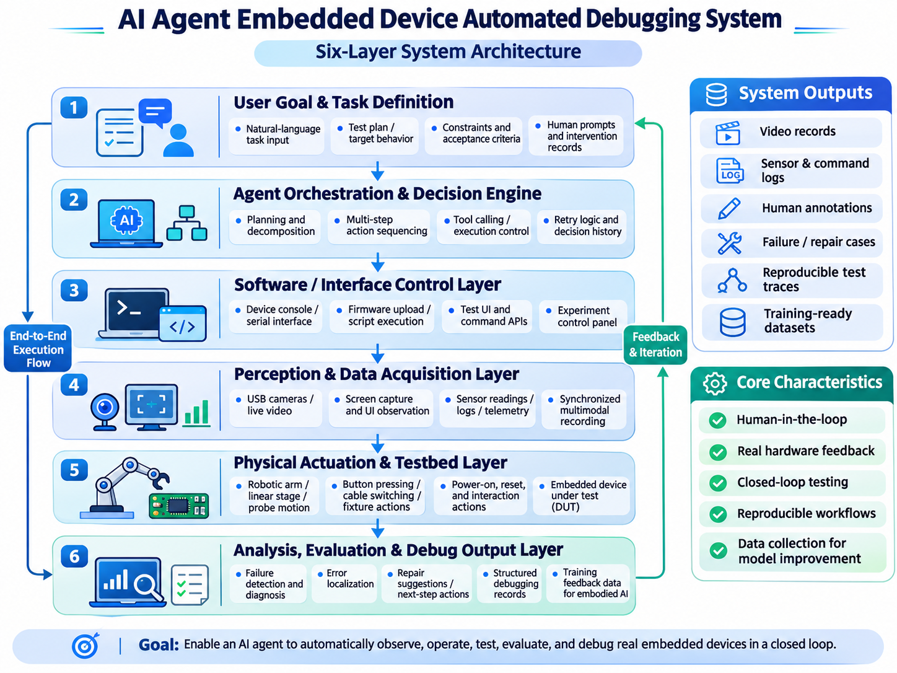
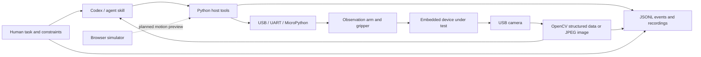
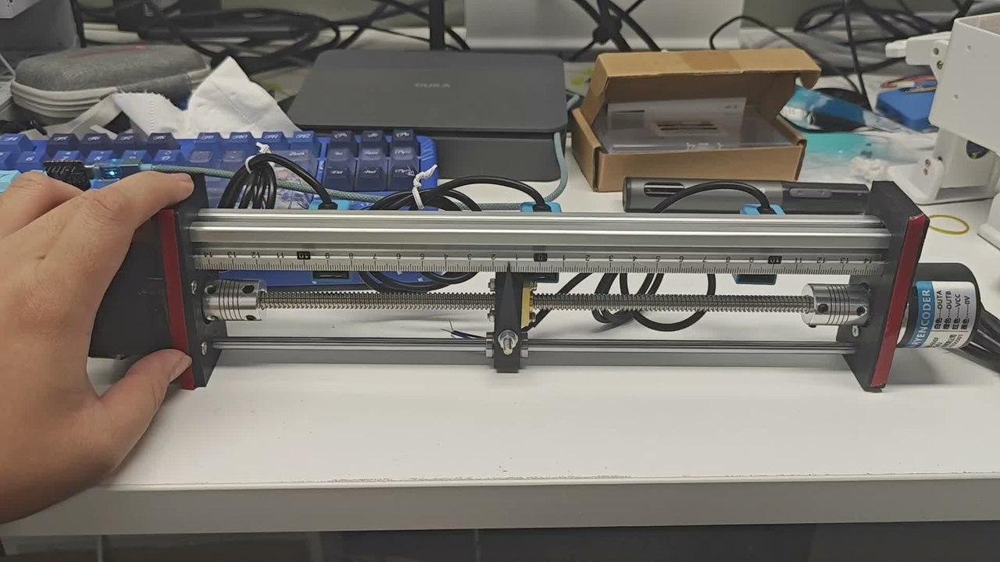
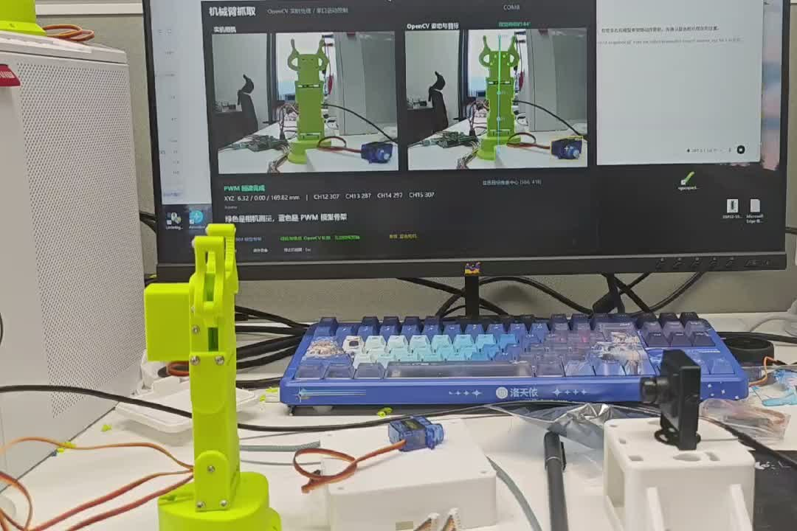

[English](README.md) | [简体中文](README.zh-CN.md)

<div align="center">

# AI Agent Embedded Device Debugging Kit

**An open-source hardware toolchain that enables AI agents to observe, control, measure, and debug real embedded devices.**

[](LICENSE)
[](environment.yml)
[](drivers/micropython)
[](#current-capabilities)

Observe real hardware. Take a physical action. Inspect the evidence. Correct and repeat.

</div>



*System design overview. The diagram includes the intended complete system; the capability table below distinguishes available tools, limited validation, and planned modules.*

## Contents

[Overview](#overview) · [Architecture](#system-architecture) · [Hardware](#hardware-toolchain) · [Capabilities](#current-capabilities) · [Experiments](#real-world-experiments) · [Quick start](#quick-start) · [Documentation](#documentation) · [Contributing](#contributing) · [License](#license)

## Overview

This project brings cameras, motion control, embedded interfaces, visual processing, and experiment records into one desktop hardware debugging workspace for agents such as Codex. Embedded boards, PCBs/PCBAs, screens, sensors, and electronic prototypes are the devices under test.

The current implementation centers on an observation arm, a USB camera, host-side Python tools, a browser motion simulator, and structured experiment tooling. The linear-stage driver, board firmware, examples, tests and hardware records are maintained directly in this kit. Thermal, power, audio, illumination, and integrated controller modules remain separate development tracks.

The repository was renamed from `micropython-robot-arm`; its history, `robot_arm` import name, and single-file MicroPython distribution are retained.

## Why this project

Generated firmware cannot establish whether a display actually updated, a gripper made contact, or a mechanism reached its target. Those questions need physical feedback.

The toolchain connects agent actions to fresh images, controller responses, and experiment records. OpenCV can extract structured observations, while a multimodal agent can also inspect real camera frames directly. This makes failures, corrections, and human interventions part of the engineering record.

## System architecture

The six-layer diagram above describes the target system. The following flow shows how the current implementation connects its existing tools:



The simulator previews geometry and command semantics. It does not certify collision clearance, load capacity, physical position, or motion completion.

## Hardware toolchain

| Layer | Scope | Implementation boundary |
| --- | --- | --- |
| Physical testbed | Development boards, PCBs/PCBAs, prototypes, fixtures | Each experiment needs an identified device and local setup |
| Observation and measurement | USB/stereo cameras, positioning, OpenCV, MLX90640, USB audio, voltage/current/power, WS2812 | USB camera and visual tools are available; other modules have individual status below |
| Physical actuation | Stepper axes, servos, arm, gripper, linear stage | Existing UART arm tools and an in-tree finite-pulse stage driver |
| Embedded control | MicroPython, USB/UART/GPIO, sensors and custom PCBs | ESP32-C3 integrated controller is planned; current stage bring-up uses XIAO ESP32S3 and TB6600 |
| Agent software | Codex, skills, Python APIs, serial and camera tooling | Existing skill and module-specific tools; a universal multi-device SDK is a goal |
| Experiment feedback | Tasks, actions, responses, images, video, interventions, failures and corrections | JSONL/recording tools exist; full cross-module measurement trace coverage is a goal |

## Software architecture

| Location | Responsibility |
| --- | --- |
| [`host_control/`](host_control) | UART adapter, persistent session, event and scan tools |
| [`drivers/micropython/`](drivers/micropython) | Arm and linear-stage driver sources maintained in this repository |
| [`camera/`](camera), [`recording/`](recording), [`visual_observation/`](visual_observation) | Shared capture, recording, and raw-image monitor |
| [`perception/`](perception/README.md), [`observation/`](observation/README.md) | Reusable visual algorithms and structured/image observation paths |
| [`hardware/`](hardware/README.md), [`firmware/`](firmware/README.md), [`mechanical/`](mechanical/README.md) | Component status, board setup, CAD and provenance |
| [`examples/`](examples), [`simulator/`](simulator/README.md) | Device examples, historical PoCs, browser preview |
| [`.agents/skills/`](.agents/skills), [`safety/`](safety) | Agent operation instructions and existing experiment checks |

Legacy root scripts and `cv_pipeline/` remain compatibility entry points. New integrations should use package paths. Runtime images, video, and local configuration belong in ignored `.runtime/` directories.

## AI agent integration

Read [`AGENTS.md`](AGENTS.md) and the [robot-arm-control skill](.agents/skills/robot-arm-control/SKILL.md) before working with devices. The skill documents the persistent serial session, camera, simulator, parameters, and operational limits.

Two observation paths are implemented:

- **Structured:** capture → visual processing → JSONL → agent. `python -m observation.structured PATH/pose_stream.jsonl` reads an existing stream without controlling hardware.
- **Multimodal:** `python -m observation.multimodal --output .runtime/frame.jpg` captures an image and metadata. The agent host must open or attach the actual image; a filename alone is not visual input.

Frame/evidence identifiers connect the paths. Image metadata records PC receipt time rather than claiming sensor exposure time. Controller `ok` is an acknowledgement, and must be distinguished from observed physical completion.

## Current capabilities

| Capability | Current evidence and limits | Details |
| --- | --- | --- |
| Observation arm and gripper | UART driver, persistent session, scanning, simulator and mounting models; physical calibration remains setup-specific | [Arm](docs/components/observer_arm.md) |
| USB camera and recording | JPEG/MJPEG server, monitor and FFmpeg recording; stereo depth and precise calibration are not verified | [Monitor](docs/setup/monitor.md), [recording](docs/recording.md) |
| Linear stage | XIAO ESP32S3/TB6600 finite-pulse driver; documented bidirectional bring-up and software stop; no calibrated mm positioning, homing, limits or closed-loop control | [Stage and validation](docs/components/linear_stage.md) |
| Integrated motion PCB | ESP32-C3, multi-axis stepper/servo controller design track | [Controller](docs/components/stepper_servo_controller.md) |
| WS2812 illumination | Prototype/reference material exists; suite integration remains planned | [Lighting](docs/components/lighting.md) |
| Voltage/current/power and switching | Measurement and device power-cycling design; no integrated measurement API delivery claimed | [Power](docs/components/power_meter.md) |
| MLX90640 thermal imaging | Planned temperature-matrix acquisition and host heatmap workflow | [Thermal](docs/components/thermal.md) |
| USB microphone array and audio | Planned direct PC connection and recording/playback tools | [Audio](docs/components/audio.md) |
| Experiment traces | JSONL events, visual streams, video and recovery tools; historical experiments require their original device setup | [Historical PoCs](examples/historical_poc/README.md) |

Software stopping and controller acknowledgements do not replace independent hardware protection or observation of the actual mechanism.

## Real-world experiments



*Still from a recorded linear-stage bring-up. Open-loop motion evidence does not establish positioning accuracy or stopping distance.*



*Historical green-arm PoC, cropped from a real experiment video. It illustrates the observation/action feedback process; these devices are optional historical examples.*

The [historical PoC workspace](examples/historical_poc/README.md) includes device-specific visual processing, phased experiments, event recording, and recovery tools. The [stage records](docs/components/linear_stage-verification.md) distinguish commanded pulses, RMT completion, user observations, and unmeasured physical quantities. Retain those distinctions when reproducing or comparing experiments.

## Quick start

### 1. Clone and prepare the host

Use Python 3.12 with the [reproducible Conda setup](docs/setup/conda-environment.md), or install the minimal host dependencies:

```sh
git clone https://github.com/FreakStudioCN/ai-agent-embedded-debugging-kit.git
cd ai-agent-embedded-debugging-kit
python -m pip install -r requirements-pc.txt -r requirements-monitor.txt
```

A normal clone includes the stage code; no submodule initialization or separate library checkout is required. Use an authorized Git identity for this private repository. Install FFmpeg for camera capture/recording and optional Node.js for simulator checks. For OpenCV processing, also install `requirements-vision.txt`. Dependency layers and version records are described in the Conda guide.

The stage [procurement/specification record](hardware/linear_stage/specifications.md) includes the original marketplace link, confirmed wiring and outstanding dimensions. [CAD status](mechanical/linear_stage/README.md) explicitly records that CAD is not yet supplied; the listing and photographs are not CAD. Historical source/license/commits remain in [provenance](hardware/linear_stage/provenance.json).

### 2. Start observation

Select the actual camera name for your host; `2M` is an example from the existing Windows setup:

```sh
python -m camera.server --device "2M"
```

In another terminal:

```sh
python -m visual_observation
```

Open `http://127.0.0.1:8766/`; the snapshot endpoint is `/snapshot.jpg`. These commands start observation without issuing motion commands.

### 3. Preview and connect

```sh
python -B simulator/serve.py
python -m host_control.session --port YOUR_PORT
```

The simulator is at `http://127.0.0.1:8767/`. Enumerate the connected serial devices before choosing `YOUR_PORT`. Within the session, `G4 S0` checks communication, `:snapshot` captures an image, and `:quit` closes the connection while preserving motor state. Follow the skill and the actual setup before enabling, homing, gripping, or moving.

### 4. Install the standalone MicroPython arm driver

```sh
python -m pip install mpremote
mpremote connect YOUR_PORT fs cp robot_arm.py :robot_arm.py
```

Import with `from robot_arm import RobotArm`. Root `robot_arm.py` and `example.py` are standalone distribution copies; maintain the sources in `drivers/micropython/robot_arm.py` and `examples/micropython/main.py`, then run `python tools/sync_driver.py`. The root `package.json` remains a driver-only mip manifest at version `0.1.0`.

## Documentation

- [Environment and dependency setup](docs/setup/conda-environment.md)
- [In-tree linear-stage maintenance and deployment](docs/setup/linear-stage-maintenance.md)
- [Observation interfaces](observation/README.md) and [reusable perception algorithms](perception/README.md)
- [Linear-stage example](examples/linear_stage/README.md) and [sensor interface reservations](hardware/linear_stage/sensor-inputs.md)
- [Simulator limitations and upstream models](simulator/README.md)
- [Experiment safety](docs/experiments/experiment-safety.md)
- [Asset provenance](docs/assets/readme/README.md) and [third-party notices](THIRD_PARTY_NOTICES.md)

## Related projects

| Project | Focus |
| --- | --- |
| [MPY Hardware Extension](https://github.com/FreakStudioCN/mpy-hardware-extension) | Hardware-aware MicroPython development in VS Code |
| [MicroPythonOS AI App Builder](https://github.com/FreakStudioCN/micropythonos-ai-app-builder) | AI-assisted MicroPythonOS app generation, preview and packaging |

These are independent projects with complementary goals; this repository does not claim a complete integration with either one.

## Contributing

Contributions to device adapters, reproducible experiments, calibration, documentation, and component integration are welcome. Include device identity, firmware version, commands, observed results, limitations, and redacted evidence when reporting hardware behavior. Keep experimental device logic in `examples/` and reusable algorithms in their shared packages.

For documentation changes, check paths and examples. For code changes, follow [`AGENTS.md`](AGENTS.md) and run the documented offline checks. Offline tests cannot establish new hardware validation.

## License

Project-owned software is distributed under the [MIT License](LICENSE). The existing `RobotArm UART contributors` copyright notice is retained from the project's history; the repository rename does not transfer ownership.

Third-party CAD/graphics, GPL firmware references, Three.js, and the imported linear-stage source retain their original licenses. See [THIRD_PARTY_NOTICES.md](THIRD_PARTY_NOTICES.md) before redistributing those materials.
