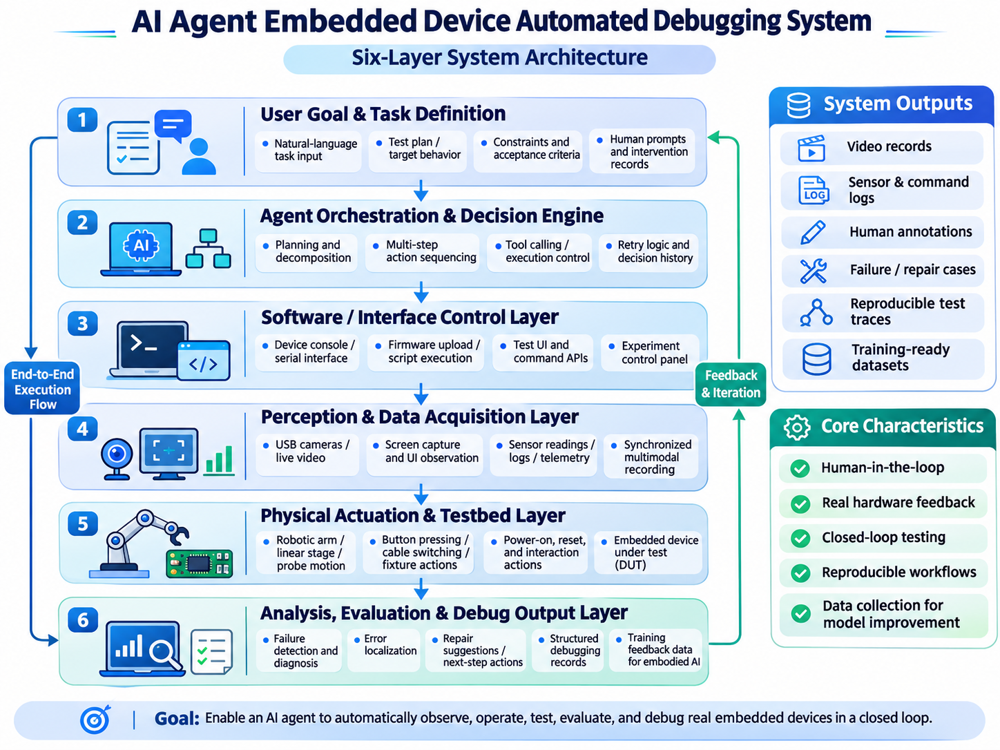
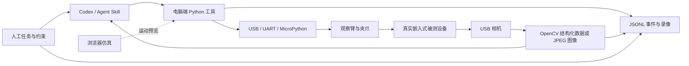
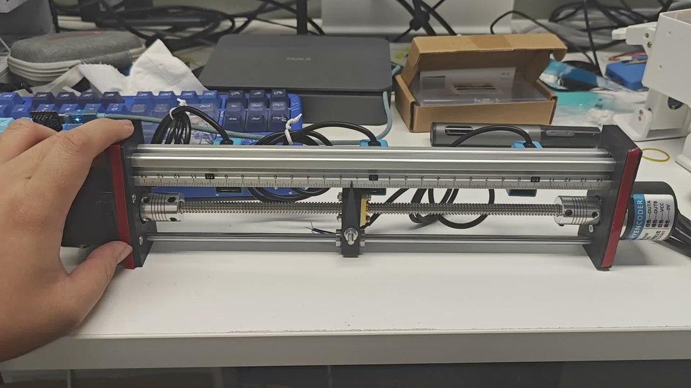
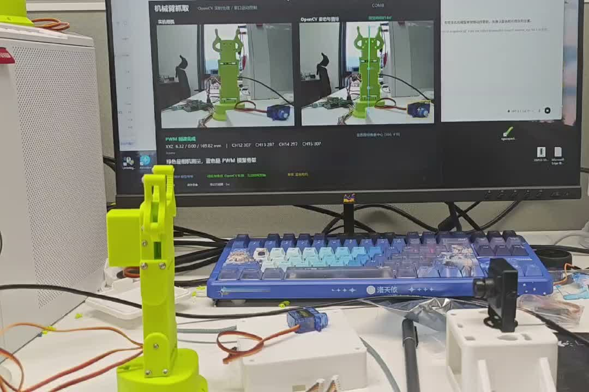

[English](README.md) | [简体中文](README.zh-CN.md)

<div align="center">

# AI Agent Embedded Device Debugging Kit

**让 AI Agent 能够观察、控制、测量和调试真实嵌入式设备的开源硬件工具链。**

[](LICENSE)
[](environment.yml)
[](drivers/micropython)
[](#当前能力)

观察真实硬件，执行物理动作，根据证据检查结果，再修正与复测。

</div>



*整体方案示意图，包含目标系统的完整范围。已可用工具、有限验证与规划模块以本文状态表为准。*

## 目录

[项目概述](#项目概述) · [系统架构](#系统架构) · [硬件工具链](#硬件工具链) · [当前能力](#当前能力) · [真实实验](#真实实验) · [快速开始](#快速开始) · [技术文档](#技术文档) · [参与贡献](#参与贡献) · [许可证](#许可证)

## 项目概述

本项目为 Codex 等 AI Agent 提供桌面嵌入式硬件调试工作区，统一组织摄像头、运动控制、嵌入式接口、视觉处理和实验记录。被测对象可以是开发板、PCB/PCBA、显示屏、传感器或电子原型。

当前实现以观察机械臂、USB 相机、电脑端 Python 工具、浏览器运动仿真及结构化实验工具为中心，线轨驱动、板端配置、例程与测试也在本套装内直接维护。热成像、功耗、音频、补光和综合控制板分别按各自进度推进。

仓库由 `micropython-robot-arm` 更名，保留 Git 历史、`robot_arm` 导入名及 MicroPython 单文件分发方式。

## 为什么需要它

生成固件并不能证明显示屏真正更新、夹爪已经接触物体或机构到达目标。硬件开发需要实际反馈。

这套工具把 Agent 动作与新鲜图像、控制器响应和实验记录关联起来。OpenCV 可提供结构化观测，多模态 Agent 也可直接检查真实相机画面。失败、修正与人工干预因此能够成为可追溯的工程过程。

## 系统架构

上方六层图描述完整目标系统；以下流程图对应当前已有工具的连接方式：



仿真提供几何与指令语义预览，不代表碰撞、负载、实际位置或停稳验收。

## 硬件工具链

| 层次 | 组成范围 | 实现边界 |
| --- | --- | --- |
| 真实实验台 | 开发板、PCB/PCBA、样机、工装 | 每次实验需要核对设备身份和现场条件 |
| 观察与测量 | USB/双目相机、观察定位、OpenCV、MLX90640、USB 音频、电压/电流/功率、WS2812 | USB 相机与视觉工具可用，其余按下表分别登记 |
| 物理操作 | 步进轴、舵机、机械臂、夹爪、线轨 | 已有 UART 臂工具及独立有限脉冲线轨驱动 |
| 嵌入式控制 | MicroPython、USB/UART/GPIO、传感器、自研 PCB | ESP32-C3 综合控制器仍规划；现有线轨使用 XIAO ESP32S3/TB6600 |
| Agent 软件 | Codex、Skill、Python API、串口及相机工具 | 已有操作 Skill 和模块接口，统一多设备 SDK 是后续目标 |
| 实验反馈 | 任务、动作、响应、图像、视频、干预、失败、修正 | JSONL 和录像工具已存在，跨模块测量记录尚待完善 |

## 软件架构

| 位置 | 职责 |
| --- | --- |
| [`host_control/`](host_control) | UART 适配、长连接会话、事件与扫视工具 |
| [`drivers/micropython/`](drivers/micropython) | 机械臂驱动维护源与固定版本的套装内线轨源码 |
| [`camera/`](camera)、[`recording/`](recording)、[`visual_observation/`](visual_observation) | 共享采集、录像与原始图像监控 |
| [`perception/`](perception/README.md)、[`observation/`](observation/README.md) | 通用视觉算法及结构化/图像双观察路径 |
| [`hardware/`](hardware/README.md)、[`firmware/`](firmware/README.md)、[`mechanical/`](mechanical/README.md) | 组件状态、板级配置、CAD 与来源记录 |
| [`examples/`](examples)、[`simulator/`](simulator/README.md) | 设备示例、历史 PoC、浏览器仿真 |
| [`.agents/skills/`](.agents/skills)、[`safety/`](safety) | Agent 操作说明与现有实验检查 |

根目录旧脚本与 `cv_pipeline/` 继续提供兼容入口。新增集成使用包路径，运行图像、录像和本机配置放在被忽略的 `.runtime/` 中。

## AI Agent 接入

操作设备前读取 [`AGENTS.md`](AGENTS.md) 与 [robot-arm-control Skill](.agents/skills/robot-arm-control/SKILL.md)，核对长连接串口、相机、仿真、参数和现场限制。

已实现两种观察方式：

- **结构化数据**：采集 → 视觉处理 → JSONL → Agent。`python -m observation.structured PATH/pose_stream.jsonl` 可读取已有流，不控制硬件。
- **多模态看图**：`python -m observation.multimodal --output .runtime/frame.jpg` 获取真实图像和元数据。Agent 宿主必须打开或附加图片，路径字符串本身不是视觉输入。

两条路径通过帧与证据标识关联。时间元数据是电脑接收时间，不冒称传感器曝光时间。控制器返回 `ok` 是指令确认，需要与物理动作完成分开记录。

## 当前能力

| 能力 | 当前证据和限制 | 详情 |
| --- | --- | --- |
| 观察臂与夹爪 | UART 驱动、长连接、扫视、仿真和安装模型；实机标定依现场条件 | [机械臂](docs/components/observer_arm.md) |
| USB 相机和录像 | JPEG/MJPEG 服务、监控、FFmpeg 录像；未验证双目深度和精确标定 | [监控](docs/setup/monitor.md)、[录像](docs/recording.md) |
| 线轨 | XIAO ESP32S3/TB6600 有限脉冲驱动，已有双向开环调试与软件停止记录；无毫米定位、回零、限位或闭环控制 | [线轨与验证](docs/components/linear_stage.md) |
| 综合运动 PCB | ESP32-C3、多轴步进和舵机控制方案 | [控制板](docs/components/stepper_servo_controller.md) |
| WS2812 补光 | 已有原型/参考素材，套装集成仍规划 | [灯光](docs/components/lighting.md) |
| 电压/电流/功率及电源开关 | 测量和断电重启方案，未宣称交付整合测量 API | [功率计](docs/components/power_meter.md) |
| MLX90640 | 温度矩阵采集与电脑热图流程仍规划 | [热成像](docs/components/thermal.md) |
| USB 麦克风阵列和音频 | 规划直接接入电脑并提供录音/播放工具 | [音频](docs/components/audio.md) |
| 实验记录 | 已有 JSONL、视觉流、录像和恢复工具；历史实验依赖原设备环境 | [历史 PoC](examples/historical_poc/README.md) |

软件停止及控制器确认不能替代独立硬件保护，也不能替代对机构实际状态的观察。

## 真实实验



*取自真实线轨调试录像。开环运动证据不代表定位精度或停止距离已经测量。*



*取自真实实验视频并裁剪的历史绿色机械臂 PoC，展示观察—动作—反馈过程；这些设备不是当前主线安装前提。*

[历史 PoC 工作区](examples/historical_poc/README.md) 保留设备专用视觉处理、分阶段实验、事件记录和恢复工具。[线轨验证记录](docs/components/linear_stage-verification.md) 区分命令脉冲、RMT 完成、现场观察和未测物理量。复现或比较实验时应保留这些边界。

## 快速开始

### 1. 克隆并准备电脑环境

建议使用 Python 3.12 和[可复建 Conda 环境](docs/setup/conda-environment.md)，也可安装最小电脑端依赖：

```sh
git clone https://github.com/FreakStudioCN/ai-agent-embedded-debugging-kit.git
cd ai-agent-embedded-debugging-kit
python -m pip install -r requirements-pc.txt -r requirements-monitor.txt
```

普通克隆已经包含线轨驱动、板端配置、例程和测试，不需要子模块初始化或独立库权限。相机采集/录像需独立安装FFmpeg，仿真检查需Node.js；按需安装requirements-vision.txt，依赖与版本记录见环境说明。

### 2. 启动观察

先选择本机实际相机名，`2M` 只是现有 Windows 环境的示例：

```sh
python -m camera.server --device "2M"
```

另一终端启动：

```sh
python -m visual_observation
```

访问 `http://127.0.0.1:8766/`，快照路径 `/snapshot.jpg`。这些命令只启动观察，不发送运动指令。

### 3. 仿真和串口连接

```sh
python -B simulator/serve.py
python -m host_control.session --port YOUR_PORT
```

仿真地址为 `http://127.0.0.1:8767/`。先枚举设备，再把 `YOUR_PORT` 替换为实际串口。会话中 `G4 S0` 检查通信，`:snapshot` 取图，`:quit` 关闭连接并保留电机状态。使能、回零、夹取和移动前，按 Skill 核对现场条件。

### 4. 安装 MicroPython 单文件驱动

```sh
python -m pip install mpremote
mpremote connect YOUR_PORT fs cp robot_arm.py :robot_arm.py
```

板端使用 `from robot_arm import RobotArm`。根目录 `robot_arm.py`、`example.py` 是独立分发副本；维护源分别为 `drivers/micropython/robot_arm.py`、`examples/micropython/main.py`，修改后运行 `python tools/sync_driver.py`。根 `package.json` 保留 `0.1.0` 驱动专用 mip 清单。

线轨[采购来源与实际规格](hardware/linear_stage/specifications.md)保留闲鱼参考、接线和待补尺寸；[机械资料状态](mechanical/linear_stage/README.md)明确尚无CAD，商品链接及照片不冒充CAD。原来源、MIT许可及提交历史见[来源记录](hardware/linear_stage/provenance.json)。

## 技术文档

- [环境与依赖](docs/setup/conda-environment.md)
- [线轨套装内维护和部署](docs/setup/linear-stage-maintenance.md)
- [观察接口](observation/README.md)与[通用感知算法](perception/README.md)
- [线轨示例](examples/linear_stage/README.md)与[传感器接口预留](hardware/linear_stage/sensor-inputs.md)
- [仿真边界与模型来源](simulator/README.md)
- [实验安全](docs/experiments/experiment-safety.md)
- [图片来源](docs/assets/readme/README.md)与[第三方声明](THIRD_PARTY_NOTICES.md)

## 相关项目

| 项目 | 方向 |
| --- | --- |
| [MPY Hardware Extension](https://github.com/FreakStudioCN/mpy-hardware-extension) | VS Code 中理解真实硬件信息并开展 MicroPython 开发 |
| [MicroPythonOS AI App Builder](https://github.com/FreakStudioCN/micropythonos-ai-app-builder) | AI 辅助生成、预览和打包 MicroPythonOS 应用 |

三个项目独立维护、目标互补，本文不宣称已完成三者的软件集成。

## 参与贡献

欢迎完善设备适配、可复现实验、标定、技术文档和组件集成。硬件问题请提供设备身份、固件版本、命令、观察结果、已知限制与脱敏证据。设备专用实验放在 `examples/`，通用算法放在共享包。

文档修改核对路径和示例；代码修改遵循 [`AGENTS.md`](AGENTS.md)，运行其中指定的离线检查。离线通过不代表新增实机验证。

## 许可证

项目自有软件采用 [MIT License](LICENSE)。保留历史中的 `RobotArm UART contributors` 版权声明，仓库更名不代表权属转移。

第三方 CAD/图形、GPL 固件参考、Three.js 和套装内线轨源码继续遵循各自许可证，分发前请阅读 [THIRD_PARTY_NOTICES.md](THIRD_PARTY_NOTICES.md)。
