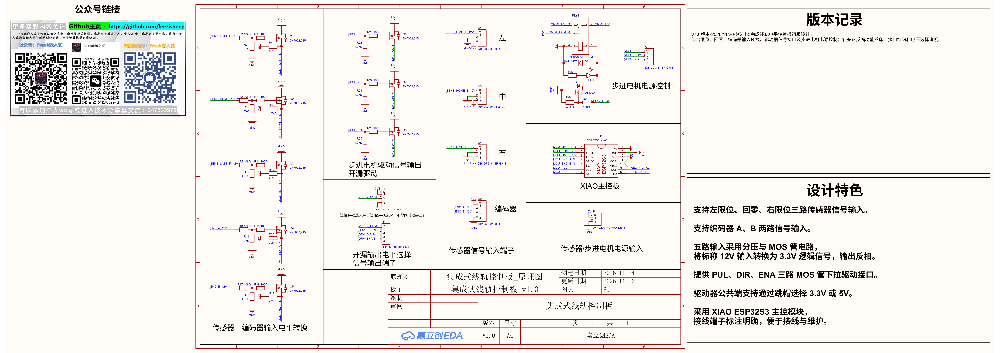
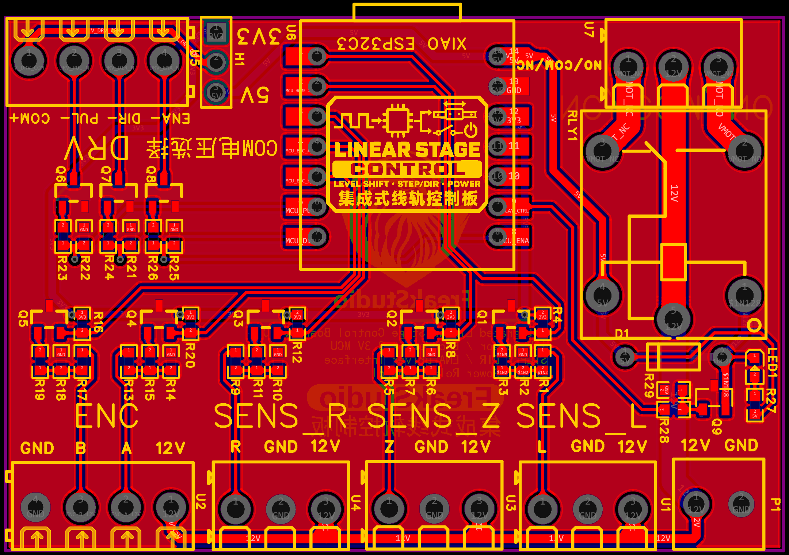
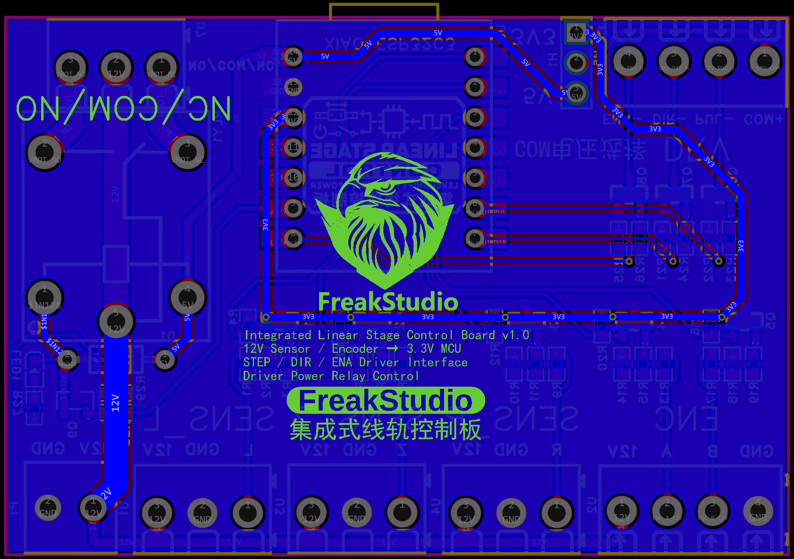
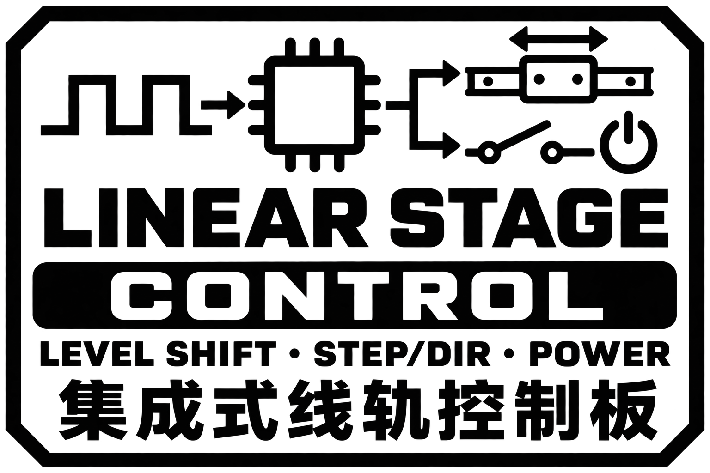

# 集成式线轨控制板 v1.0｜2026-11-26 图面归档

本次由原线轨输入电平转换板扩展为集成式线轨控制板，新增步进电机驱动器电源控制继电器。主控按用户确认可选 XIAO ESP32S3 或 XIAO ESP32C3；原理图标注S3，原BOM列C3，替代关系及GPIO差异见下方说明。

## 工程与项目入口

- [嘉立创可编辑工程](https://u.lceda.cn/account/user/projects/index/detail?project=787da6d030f54902b2a4eebc46c4ca98&listType=all)（用户提供，访问权限由工程所有者管理）
- [套装开发任务说明](https://f1829ryac0m.feishu.cn/docx/Jwo1dIiAGoc7iUxGVMMcQfZrnGm)

此目录归档用户提供的工程截图及新 ICON，包含最新BOM原始导出，尚未包含嘉立创原生工程导出或Gerber生产文件。截图不替代可编辑工程。

## 接线、BOM与主控选型

- [接线说明：运动控制信号与驱动器电源开关分开定义](wiring.md)
- [最新BOM及装配替代说明](bom-notes.md)
- [XIAO ESP32S3 / ESP32C3可替换说明与GPIO映射](controller-options.md)
- [飞书待更新内容（尚未写入云文档）](feishu-pending-update.md)

## 本次内容

| 文件 | 用途 |
| --- | --- |
| [schematic.png](schematic.png) | 原理图截图，含输入转换、驱动信号输出及继电器电源控制 |
| [pcb-front.png](pcb-front.png) | PCB 正面截图 |
| [pcb-back.png](pcb-back.png) | PCB 背面截图，含品牌、板名、版本及功能说明 |
| [icon-transparent.png](icon-transparent.png) | 新功能 ICON，黑色图形、透明背景，供丝印导入 |
| [icon-preview.png](icon-preview.png) | ICON 白底预览，便于查看 |
| [manifest.json](manifest.json) | 原文件名、尺寸、文件大小及 SHA-256 核对记录 |

ICON 为内置 imagegen 生成的位图参考，采用粗框切角工业风：输入信号进入主控，分别控制滑台运动和电源继电器；文字为 LINEAR STAGE / CONTROL、LEVEL SHIFT · STEP/DIR · POWER、集成式线轨控制板。白底版本仅为透明图的显示预览。

图面上的版本号为 v1.0，本目录沿用该标注，并以日期区分此次归档。新 ICON 独立提供，当前 PCB 正面截图尚未放入此新 ICON，不将其描述为已完成工程导入。

## 验证范围

本次核对图片可读、BOM原文件复制一致、BOM位号数量、官方GPIO映射及资料链接路径。未执行 ERC/DRC、丝印实际尺寸与最小特征检查、继电器负载验证或实物功能测试；本归档不表示已经具备投板或整机验收条件。

## 预览

### 原理图

### PCB 正面

### PCB 背面

### 新功能 ICON

